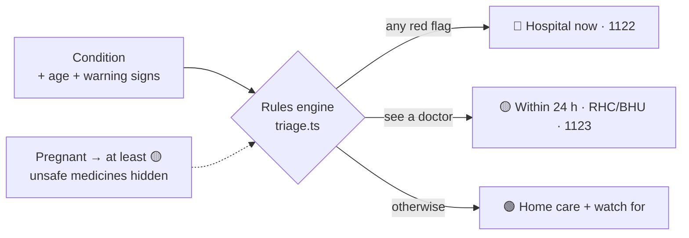

<div align="center">

# 🩺 Sehat Saathi · صحت ساٿي

**A free first-aid and triage guide for Thatta district, Sindh, in Sindhi, Urdu and English.**

[](https://thatta-health-app.lovable.app)
[](tel:1122)
[](tel:1123)


<sub>Choose a condition → enter age → tick warning signs → get a clear answer, read aloud, with the nearest hospital.</sub>

</div>

---

## Why it exists

In an emergency, a family's first questions are *"How serious is this?"* and *"Where do we go?"*. In Thatta's rural talukas the answers are often only available in English, far from home, or not at all.

Sehat Saathi answers both questions **in the family's own language** and points them to the free services they already have: the **1122** ambulance and the **1123** doctor line.

## What it does

- 🗣️ **Three languages:** Sindhi, Urdu and English.
- 🔊 **Read aloud:** every question and answer can be spoken, for users who find reading hard.
- 🧭 **Guided triage:** pick a condition (fever, diarrhoea, heat stroke, snakebite…), give the age in months or years, and tick any warning signs.
- 🚦 **A clear three-tier answer, with the reasons shown:**

  | Tier | What the app says |
  |---|---|
  | 🔴 **Red** | *Emergency: go to hospital now.* Call 1122 or go to the nearest hospital immediately, with first-aid steps while you wait. |
  | 🟡 **Yellow** | *See a doctor within 24 hours.* Nearest RHC or BHU, or call 1123 for free advice. |
  | 🟢 **Green** | *You can care for this at home.* Home-care steps, and the warning signs to watch for. |

- 🏥 **Nearby facilities:** DHQ, RHC and BHU listings across Thatta, Mirpur Sakro, Ghorabari and Keti Bandar.
- 🤰 **Pregnancy-aware:** any illness during pregnancy is raised to at least yellow, and medicines unsafe for the user's age or pregnancy are hidden, with a note saying so.

## Safety by design

**No model decides how serious something is.** The tier comes from a small, deterministic rules engine ([`src/lib/triage.ts`](src/lib/triage.ts)) applied to doctor-reviewed content in [`src/lib/content.ts`](src/lib/content.ts):



- Rules are deliberately tiny (for example `age_months < 3`), so they can be read and checked by a clinician.
- The highest tier wins: one red warning sign always means red.
- Time matters too: if an illness lasts longer than its safe home-care period, the answer is raised to *see a doctor*.
- Every result shows **why** it was given, in the user's language.

## Tech stack

`React 19` · `TypeScript` · `TanStack Start & Router` · `Tailwind CSS 4` · `Vite` · `Zod` · `shadcn/ui (Radix)` · `Web Speech API` for read-aloud · built and hosted with [Lovable](https://lovable.dev)

## Run it locally

```sh
git clone https://github.com/maryamfaizan53/thatta-health-app.git
cd thatta-health-app
npm install
npm run dev
```

## Project structure

```
src/
├── lib/
│   ├── triage.ts       # deterministic triage engine (green / yellow / red)
│   ├── content.ts      # conditions, warning signs and advice in sd / ur / en
│   ├── facilities.ts   # DHQ, RHC and BHU listings with locations
│   └── i18n.tsx        # languages, RTL and read-aloud
└── routes/
    ├── index.tsx              # home: choose a condition
    ├── triage.$condition.tsx  # questions and result
    ├── hospitals.tsx          # nearby facilities
    └── about.tsx
```

## ⚠️ Medical disclaimer

Sehat Saathi gives **general first-aid guidance only**. It is not a diagnosis and does not replace a doctor. **In an emergency, call 1122 immediately.**

---

<div align="center">

Built by **[Maryam Faizan](https://www.maryamfaizan.online)**, Agentic AI Developer, Karachi ·
[More of my work](https://github.com/maryamfaizan53)

</div>
